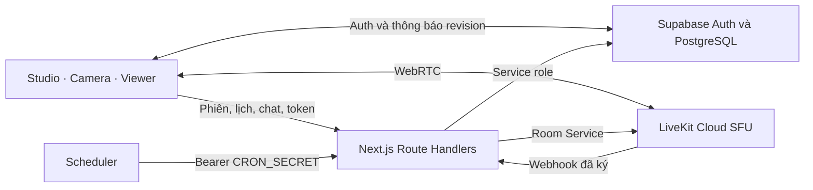
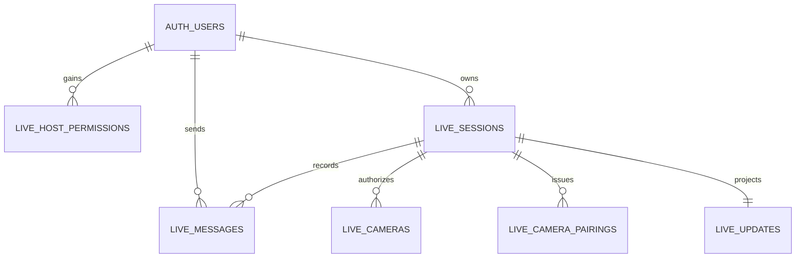

# Kiến trúc và dữ liệu NaiFarm Live

## Quyết định kiến trúc

1. LiveKit Cloud xử lý signaling, ICE/TURN và WebRTC SFU để Vercel chỉ chạy HTTP API và tác vụ ngắn. Player dùng LiveKit JS SDK trực tiếp để điều khiển video subscription theo góc, track chính cấp audio. Giới hạn pilot là 30 participant gồm host và camera phụ.
2. Supabase Postgres Changes thông báo qua bảng projection vì có thể tái sử dụng snapshot HTTP làm dữ liệu có thẩm quyền khi sự kiện đến trễ hoặc mất kết nối. Broadcast cần cơ chế phát sau khi ghi và tự khôi phục dữ liệu. Presence không đại diện chính xác cho participant đang kết nối media, nên số người xem lấy từ LiveKit.
3. Pilot Auth dành riêng cho livestream tránh thay đổi cơ chế role demo của toàn ứng dụng. UUID tài khoản và quyền theo vườn được xác minh ở server trước thao tác ghi. Một phiên giữ chỗ toàn hệ thống để giới hạn mức tiêu thụ và đơn giản hóa retry dọn room.
4. Ghép điện thoại bằng bearer ngắn hạn, một lần, tránh yêu cầu đăng nhập trên camera phụ. Browser giữ mã ở fragment rồi bỏ khỏi URL. Token chỉ cho phép camera publish video trong room của phiên.

## Lược đồ

| Bảng | Constraint và quyền |
| --- | --- |
| `live_host_permissions` | Khóa `(user_id, farm_id)`. `enabled` và `can_chat` được đọc qua server. Farm rỗng cấp quyền chat mà không cấp quyền tổ chức tại vườn. |
| `live_sessions` | UUID, owner, farm, room duy nhất, lịch UTC, trạng thái, sản phẩm, revision và metadata worker. Unique index một chỗ phát giữ cả phiên đang cleanup. Index trạng thái/giờ cho danh sách. Request ID theo owner hỗ trợ retry tạo lịch. |
| `live_messages` | FK phiên và sender, nội dung, tên, thời gian, `hidden_at`. Unique theo sender và mã yêu cầu. Index theo phiên/thời gian/ID. API giới hạn lịch sử công khai trong 30 ngày. |
| `live_camera_pairings` và `live_cameras` | Chỉ lưu SHA-256 của mã ngẫu nhiên 32 byte. Mã sống 5 phút, cấp lại vô hiệu hóa mã cũ chưa dùng. Redeem và giữ chỗ camera khóa hàng phiên trong cùng transaction. |
| `live_updates` | Khóa phiên, revision phiên và revision chat. Client anon/authenticated chỉ có quyền SELECT qua RLS. Publication `supabase_realtime` chứa bảng này. |
| `live_webhook_events` và `live_rate_limits` | Event ID duy nhất cho việc nhận trùng. Rate limit ở PostgreSQL để các server instance dùng chung giới hạn. |

Hai migration chạy theo thứ tự [202611250002](../../supabase/migrations/202611250002_livestream.sql) và [202611250003](../../supabase/migrations/202611250003_live_realtime.sql). Các bảng dữ liệu chính và RPC thay đổi nghiệp vụ được cấp quyền cho server. Revocation của migration thứ hai thu hồi quyền đọc trực tiếp phiên/chat ở client và đưa thông báo qua projection.

## Đồng bộ và dọn phòng

Trigger cập nhật projection trong cùng transaction với thay đổi phiên hoặc chat. Kênh viewer chi tiết lọc theo UUID phiên. Trang danh sách bỏ qua tín hiệu khi revision phiên đã thấy. Browser lấy dữ liệu qua Next.js khi subscribe thành công và khi có sự kiện. Mỗi lần đọc có số thứ tự để tránh một response cũ ghi đè response mới.

LiveKit phát sự kiện room, participant và track. Webhook yêu cầu chữ ký rồi kích hoạt đối chiếu với Room Service. Studio cũng kích hoạt qua các lượt đọc phiên mỗi tám giây khi đang phát. Worker tương tranh qua lease và chỉ lưu sau khi kiểm tra lại status, revision và lease. Retry giữ khóa chỗ phát cho tới khi room đã biến mất. [Mã lifecycle](../../src/lib/live/lifecycle.ts)
