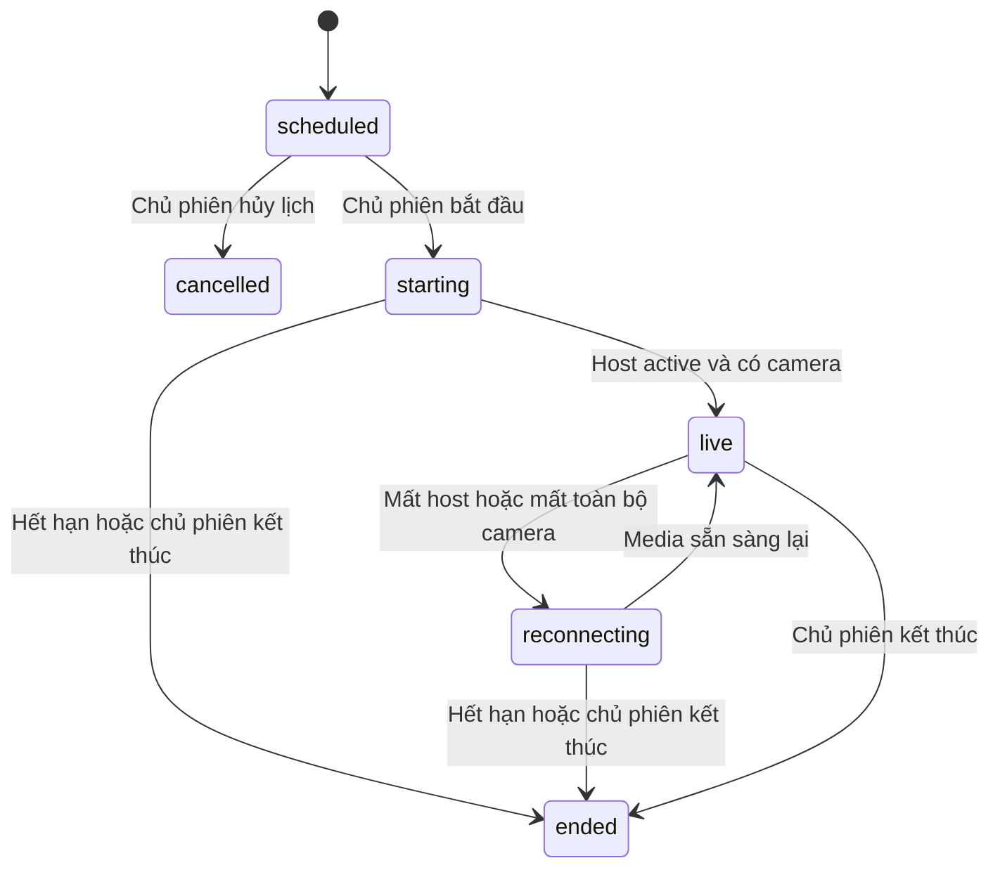

# Đặc tả NaiFarm Live

## Bối cảnh và phạm vi

Trang cũ trình bày lịch, góc quay và thương mại bằng dữ liệu minh họa. Luồng này nằm ở `/live/demo`. Trang `/live` đọc lịch từ Supabase, dùng LiveKit để phát media và hiển thị trạng thái lỗi khi chưa có kết nối đến hệ thống. Catalog nhà vườn, giá, truy xuất QR và giỏ hàng vẫn dùng dữ liệu demo sẵn có.

Pilot gồm chủ phiên có quyền theo nhà vườn và tài khoản chỉ có quyền chat. Khách có thể xem chương trình và đọc chat. Mỗi phiên có một laptop chính, tối đa một camera điện thoại và nhiều viewer. Chỉ một phiên được mở tại một thời điểm. Mọi viewer cùng nhận góc camera đang được chọn. Laptop cung cấp mic cho cả hai góc.

## Vòng đời phiên

- Lịch được tạo bằng mã yêu cầu dùng lại khi retry. Chủ phiên có thể sửa lịch chưa bắt đầu. Hủy là chuyển trạng thái để giữ lịch sử. Có thể phát thủ công trước giờ lịch.
- Thời gian lịch lưu bằng UTC, nhập và hiển thị theo giờ Việt Nam. Một phiên bắt đầu với hạn 90 giây để có publisher thực sự. Room có sẵn là điều kiện cấp token. Trạng thái đang phát yêu cầu host active và có ít nhất một track camera không mute từ thiết bị được cấp quyền.
- Khi mất nguồn phát, host có 60 giây kể từ lần ghi nhận trạng thái reconnecting để khôi phục. Người dùng có thể mở lại studio rồi bấm **Kết nối camera chính**. Room có thể được tạo lại nếu provider đã đóng trong thời gian này.
- Phiên đóng hiển thị ngay cho viewer qua thay đổi trạng thái. Tiến trình dọn phòng giữ chỗ phát cho tới khi xóa room xong. Một lỗi provider lưu lần thất bại và lên lịch thử lại với backoff, tối đa hai phút giữa các lần thử.

## Luồng sử dụng và giao diện

| Màn hình | Hành vi |
| --- | --- |
| `/live` và `/live/[id]` | Xem trực tiếp, lịch, chi tiết phiên, chat, sản phẩm ghim, trạng thái tải/lỗi/rỗng. Lịch hiển thị vườn, tên hiển thị của chủ phiên, thời gian và ảnh đại diện có ghi rõ khi dùng ảnh demo. Video co theo chiều rộng, `playsInline`, âm thanh mặc định tắt và có công tắc. Có toàn màn hình khi trình duyệt hỗ trợ. Chọn góc có `aria-pressed`. Số người xem đếm kết nối có danh tính viewer, mỗi tab là một kết nối. |
| `/live/studio` và `/live/studio/[id]` | Đăng nhập pilot, tạo và hủy lịch, chọn sản phẩm, xem camera và tín hiệu mic trước khi phát. Chọn webcam/mic ở bước chuẩn bị hoặc kết nối lại. Khi phát có chất lượng kết nối, thời gian phát, trạng thái camera phụ và nút bật/tắt mic hoặc camera. Chủ phiên có thể ghép/ngắt camera phụ, ghim sản phẩm, ẩn tin nhắn và đóng phiên. |
| `/live/camera` | Đọc mã từ fragment rồi xóa fragment. Tiền kiểm camera ưu tiên camera sau, cho phép chuyển trước/sau. Chỉ phát sau thao tác của người dùng. Hiển thị trạng thái xem trước, đang phát và đã ngắt. |

Góc đang được xem nhận video theo lựa chọn của viewer. Việc camera phụ rời phòng đưa viewer về góc đang có. Chat lưu ở PostgreSQL, giới hạn 500 ký tự, lấy 30 tin gần nhất theo mặc định và cho xem thêm từng nhóm 30 tin. Tin hiển thị giờ Việt Nam và nhãn **Chủ phiên** khi người gửi là owner. Tin đã ẩn không xuất hiện trong lịch sử công khai. Sản phẩm ghim phải thuộc danh sách của phiên, thao tác bỏ ghim dùng giá trị rỗng và viewer mới lấy trạng thái hiện hành qua API.

Thẻ sản phẩm ghim dùng catalog, giá, trạng thái tồn kho và liên kết truy xuất của bản demo. **Đặt nhanh (COD Demo)** thêm một đơn vị qua giỏ hàng hiện có rồi chuyển tới trang checkout để khách kiểm tra và xác nhận.

## Yêu cầu vận hành và phần còn thiếu

### Đồng bộ góc camera

Viewer chọn camera chính hoặc camera điện thoại đang phát. Lựa chọn lưu trong phiên, được gửi đến mọi viewer qua Supabase Realtime và chỉ được API chấp nhận khi participant đang publish video trong LiveKit. Nếu camera phụ ngắt, viewer tự fallback sang camera chính.

- Media dùng WebRTC trực tiếp qua LiveKit SFU. Postgres Changes thông báo thay đổi chat và phiên, sau đó trình duyệt đọc snapshot mới. Lần đăng ký lại kênh, cửa sổ hiển thị lại và trình duyệt online đều làm mới snapshot.
- Pilot cần môi trường HTTPS, quyền camera/mic và permission theo nhà vườn. Nội dung QR, access token và secret không đi vào log ứng dụng. Xem [quyền và hợp đồng API](API_CONTRACT.md).
- Bộ chọn thiết bị chính dùng ở bước chuẩn bị. Nếu cần chuyển webcam/mic giữa buổi phát, host mở lại studio trong cửa sổ khôi phục, chọn thiết bị và bấm **Kết nối camera chính**. Viewer vẫn chọn góc camera chính/phụ trực tiếp trong phiên. Xem trạng thái kiểm thử và các giới hạn ở [ma trận nghiệm thu](TEST_PLAN.md).
- Mục tiêu P95 dưới 1 giây cho video và dưới 500 ms cho chat/ghim cần đo trên staging. Chất lượng theo mạng yếu, Safari vật lý và mức sử dụng quota chưa được nghiệm thu.
- Recording, replay, OBS, WHIP/RTMP, phụ đề và các tính năng AI thuộc backlog tùy chọn đã nêu trong yêu cầu.
